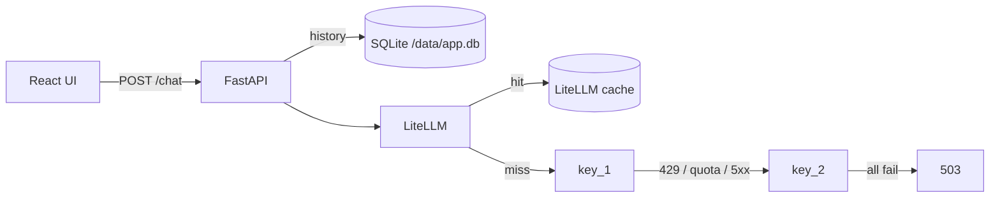

# Chat Console: LLM chatbot with key failover and response caching

React + FastAPI + SQLite, with [LiteLLM](https://docs.litellm.ai/) as the model gateway.



## 1. Live URLs

| | URL |
|---|---|
| Frontend | `https://chat-bot-six-rouge.vercel.app/` |
| Backend | `https://chatbot-9bha.onrender.com` (try `/health`) |

## 2. Run locally

**With Docker**

```bash
cp .env.example .env      # add at least two real keys to LLM_API_KEYS
make up                   # frontend :3000, backend :8000
make down
```

**Without Docker**

```bash
# backend
cd backend
python -m venv .venv && source .venv/bin/activate
pip install -r requirements.txt
export LLM_API_KEYS=key-one,key-two DATABASE_URL=sqlite:///./app.db \
       ALLOWED_ORIGINS=http://localhost:3000 ENABLE_FAILURE_SIMULATION=true
uvicorn app.main:app --port 8000

# frontend (second terminal)
cd frontend
npm install
VITE_API_BASE_URL=http://localhost:8000 npm run dev
```

Backend tests: `make test` (runs `pytest`; the provider call is faked, caching and token accounting are real LiteLLM).

## 3. Design decisions

**Key fallback.** `LLM_API_KEYS` becomes the pool `key_1`, `key_2`, ... in order. Each request calls `litellm.completion` with the first key and `num_retries=0`. Any failure (429, quota, 5xx, timeout, rejected key or empty reply) moves to the next key. Failed keys are counted in `fallback_attempts`. If every key fails the API returns `503 {"detail": "all providers unavailable"}` and nothing is written to history. Keys are never logged or returned; only `key_id` is exposed.

**Caching.** LiteLLM's built-in cache (`litellm.cache`, in-memory by default, disk with `CACHE_TYPE=disk`). The cache key is the model plus the full message list (system prompt, history and new message), so the same first message in a new session is a hit and any different message is a miss. A hit is detected from LiteLLM's own `cache_hit` flag, returns the stored reply and stored token usage, and reports `key_id: null`. Requests that use `X-Simulate-Failure` skip the cache so failover is always demonstrated with a real answer.

**SQLite session storage.** The backend stores history per `session_id`; the client only sends the new message. One transaction writes the user message and the assistant reply together, so a failed request (422 or 503) leaves no trace. The file path comes from `DATABASE_URL`, lives on a Docker named volume at `/data`, and the schema is created on startup. A small `sessions` table remembers a session's custom system prompt. Only the most recent `MAX_HISTORY_MESSAGES` are sent to the model to bound prompt size.

**Errors.** Every error is JSON with a `detail` field. Validation errors return 422, unknown sessions 404, and unexpected exceptions a generic 500. No stack traces or HTML pages. The OpenAPI/docs routes are disabled so the service exposes exactly the three contract endpoints.

## 4. Verification

Replace `$API` with the backend URL.

```bash
# health
curl $API/health

# live inference, then a cache hit (same message, new session)
curl -s $API/chat -H 'content-type: application/json' \
  -d '{"session_id":"a1","message":"What is the capital of France?"}'
curl -s $API/chat -H 'content-type: application/json' \
  -d '{"session_id":"b2","message":"What is the capital of France?"}'   # LLM_CACHE, key_id null

# failover: key_1 fails, key_2 answers
curl -s $API/chat -H 'content-type: application/json' -H 'X-Simulate-Failure: key_1=429' \
  -d '{"session_id":"c3","message":"Name a river in Italy"}'            # key_id key_2, fallback_attempts 1

# every key fails: clean 503, nothing stored
curl -si $API/chat -H 'content-type: application/json' -H 'X-Simulate-Failure: *=429' \
  -d '{"session_id":"d4","message":"hello"}'

# stored history, and a 404
curl -s $API/sessions/a1/messages
curl -si $API/sessions/unknown/messages
```

In the UI, every reply shows its source, model, latency and input/output tokens. Open **Session settings** to enter a failure header such as `key_1=429` and watch the reply note change to "Answered by key_2 after 1 failed key". The failure header only works when `ENABLE_FAILURE_SIMULATION=true`.

## 5. Setup Used

- Editor: _add yours_
- AI tools: _add yours_
- Model: Google Gemini through LiteLLM (free tier)

## 6. Bonus features

- System prompt field per session, persisted server-side.
- Markdown rendering of replies.
- In-UI field to send `X-Simulate-Failure` for demos.
- Backend test suite covering caching, failover, validation, multi-turn state and 503 handling.
- Non-root backend image and a container healthcheck.
